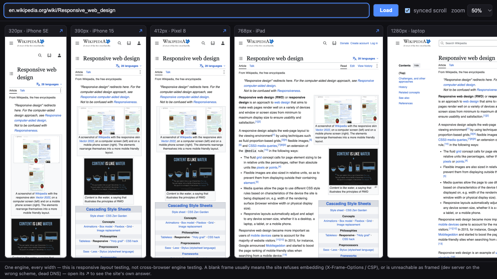

# viewport-wall

**Day 07 of 30** · [Retro](RETRO.md) · [Build log](BUILD-LOG.md)

> "Cross device testing is so much harder than I expected" — the recurring answer under r/QualityAssurance's "how are you handling cross-browser testing in 2025?", echoed across 10+ threads in 5 subreddits, 2014→2025. The free answer has been "open 6 windows" for a decade; the tools that fixed it (BrowserStack, Sizzy, Polypane) are all paid.
> [thread →](https://www.reddit.com/r/QualityAssurance/comments/1mq9712/how_are_you_handling_crossbrowser_testing_in_2025/)

One page that renders any URL in **five device-width columns at once — 320 · 390 · 412 · 768 · 1280 — with synchronized scrolling**, so a responsive layout break is something you *see*, not something you imagine from five resized windows. Type a URL, press Enter, scroll anywhere: every width moves together. Zoom (25–100%) fits the whole wall on one screen.

**Live: [shrinathprofile.github.io/30painpoints](https://shrinathprofile.github.io/30painpoints/)** — deployed build, verified on the live URL (exact widths + sync).

No accounts, no screenshots, no upload: your browser renders the sites, locally, same as visiting them.

## Run it

```bash
cd days/day-07-viewport-wall/app
npm install        # React + Vite + TS, nothing else
npm run dev        # → http://localhost:5199
```

Then type a URL and press Enter. Try, in order:

```text
localhost:5199/demo.html          # the built-in instrument page — proves each column
                                  # really lays out at 320/390/412/768/1280 (it prints
                                  # its own width, and paints a ruler every 500px)
en.wikipedia.org/wiki/Responsive_web_design   # frame-friendly real site
info.cern.ch                      # the first website, at five widths
github.com                        # refuses embedding — honest blank (see below)
```

A deployed link demos itself: `#https://example.com` in the URL fragment pre-loads the wall.



## What it is honest about (the ceilings)

- **One engine, every width.** This is responsive *layout* testing in your browser — it does not emulate Safari, IE, or any engine. Named plainly because "cross-browser" threads deserve a straight answer about what's free.
- **Some sites refuse to be framed.** GitHub, Google, most banks send `X-Frame-Options`/CSP `frame-ancestors` — those columns render blank. There is no cross-browser way to detect this from the parent, so the wall shows the blank honestly (each column has a ↗ to open the site directly) instead of a guessed "blocked!" badge that could be wrong. Wikipedia, MDN-adjacent docs, most blogs, and every localhost dev server frame fine — which is the actual use case.
- **Very long pages are cut off.** Columns render the first 40,000px of a page (`ponytail:` marker in code); a page longer than that loses its tail.
- **Scroll sync is pixel-offset, not percentage.** Same distance from the top in every column — the same-origin policy hides each page's height, so percentage sync isn't honestly possible without a cooperating page.

## The one interesting bit

The obvious sync design — "scroll the iframes" — is impossible: a parent page **cannot** scroll a cross-origin iframe, ever. The trick that makes this work with zero cooperation from any site: each iframe is rendered 40,000px tall inside a clipped, scrollable column, so the *page* never scrolls — the *column* does, and columns are ours. Sync is then `scrollTop` mirroring plus CSS `zoom` to fit five widths on one screen. ~40 lines of React, no dependencies beyond React itself.

## Checks

- `node selfcheck.ts` — 21 executed asserts on the URL trust boundary (only http(s) may become an iframe src; `javascript:`/`data:`/`mailto:`/`ftp:` refused; internal whitespace and control characters refused — Chromium would silently percent-encode spaces into a *different* URL; credentials stripped so they never reach the src/hash/↗; `localhost:5173` → `http://`, not the TLS-dead `https://localhost:5173`) and layout invariants. Final line, byte-identical at close from a clean rebuild:

  ```text
  21 checks: 21 green, 0 red
  ```

- Real-browser validation (Playwright/Chromium, dev server **and** a clean production build): columns measured at exactly 320/390/412/768/1280 via the instrument page's own DOM at every zoom; scroll-sync mirrored 1→5 columns (incl. fast scrolls, zoom changes, conflicts); sync-off independence and resync-on-toggle verified; example.com / info.cern.ch / en.wikipedia.org rendered; github.com's CSP refusal observed in console; 13 adversarial findings (1 crash, 4 wrong-results, 1 cannot-check, 7 cosmetic) all fixed or documented — full matrix in [BUILD-LOG](BUILD-LOG.md).
- Short pages leave blank scroll below their content (the frame is 40,000px tall; inner height is unknowable cross-origin) — documented ceiling, not a bug.
