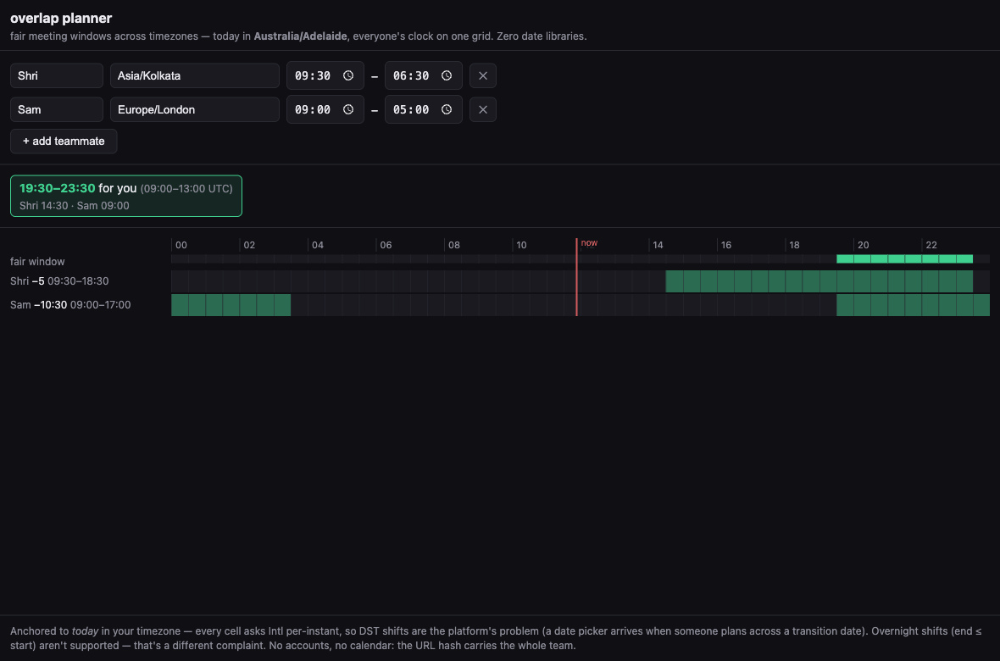

# overlap planner

**Day 09 of 30** · [Retro](RETRO.md) · [Build log](BUILD-LOG.md) · **[Live →](https://shrinathprofile.github.io/30painpoints/days/day-09-overlap-planner/#v%3D1%7CShri%7CAsia%252FKolkata%7C09%253A30%7C18%253A30%2CSam%7CEurope%252FLondon%7C09%253A00%7C17%253A00)**

> "Boss schedules meetings at 11pm my time because it works for HQ" — 169 votes, 203 comments on r/digitalnomad; 7+ sibling timezone-angst threads
> [thread →](https://reddit.com/r/digitalnomad/comments/o34nnl/timezonefu_how_do_you_work_around_massive/)

A pinnable, account-free page that answers "when can we ALL meet?" at one glance:

- **Type teammates' cities, not timezone math.** ~90 city aliases (Bengaluru, SF, İstanbul, São Paulo — diacritics fold automatically) over the browser's own full IANA list via `<datalist>`; unknown input refuses with guidance, never guesses.
- **One grid, everyone's clock.** Your local day in 48 half-hour columns; one row per teammate, green inside THEIR working hours (native `<input type="time">`), each row labeled with its offset vs you.
- **Fair windows, computed not vibes.** Contiguous all-green bands rendered as chips: viewer time + UTC + each person's local start ("14:30–17:00 for you · Sam 09:00 · Alex 21:00"). No honest-empty fudge: structurally impossible teams say "no window where everyone's hours overlap today" — and the grid shows *why*.
- **Zero date libraries.** The stack card: `Intl.DateTimeFormat` asked **per instant** — wall times, UTC offsets, DST, Lord Howe's 30-minute shift, Kathmandu's :45 — all the platform's problem. The only hand-written math is the overlap arithmetic.
- **The URL is the team.** State lives in the hash (fields percent-encoded, hostile hashes decode to defaults — never a silently-wrong team); the link above demos itself on any viewer's timezone. A red now-line tracks the current instant.



## Run it

```bash
cd app
npm install          # react + react-dom only — no date libraries, that's the point
npm run dev          # http://localhost:5200
npm run build        # dist/ deploys anywhere static (vite base: "./")
node selfcheck.ts    # 89 assert-based checks — zero deps, Node ≥ 22.18
```

## How it decides

| Decision | Rule | Why |
|----------|------|-----|
| All timezone math | `Intl.DateTimeFormat` per instant (pinned `en-GB` + `h23`) | DST correctness without owning it; unpinned locales reintroduce hour-24/AM-PM ghosts |
| UTC offset | reconstruct wall time as-if-UTC, subtract the real instant (epoch-shift trick) | one Intl call, no offset parsing |
| Local midnight | walk forward in 15-min steps to the first instant on the target wall date | the five zone/dates a year where DST swallows midnight make fixed-point iteration oscillate onto yesterday (adversarial F2) |
| City → zone | alias → exact IANA → unique suffix → anything Intl accepts → refuse | the supported-values list omits `UTC` and prefers `Asia/Calcutta`; the parser is the authority, not the list |
| Broken rows | excluded from bands + "N rows not counted" note | an ignored row that's silent is a band that lies |
| Share format | fields percent-encoded, joined `\|` and `,` — separators `encodeURIComponent` guarantees to escape | `~ ! * ' ( )` are NOT escaped — a `~` in a name used to split rows (caught by roundtrip) |
| Anchored to today | no date picker | the complaint is "boss picks a slot TODAY without seeing us"; comparing transition dates is a named upgrade |

## Validate it works

`node selfcheck.ts` — 89 checks: shell-clock gold values (both DST seasons), hand-computed fair bands, share-format roundtrips incl. separator-hostile names, and one named regression per adversarial finding (swallowed-midnight day starts, overnight-team smuggling via hash, lone-surrogate encode crash, diacritic refusals, name-cap asymmetry). Real-browser verified on a foreign-viewer timezone (Adelaide): preset links, alias typing, refusal paths, honest empties, live now-line.

## Deliberately not built

No accounts, no calendar/OAuth, no invite sending, no overnight/shift hours (end ≤ start is refused — a different complaint), no date picker, no DST guarantees beyond what Intl gives free (which is most of them). Every shortcut is marked in code with a `ponytail:` comment naming its ceiling and trigger.

## Files

- `app/src/lib.ts` — all logic, pure (no DOM) — timezone math, resolve, bands, share format
- `app/src/App.tsx` — the grid UI
- `app/selfcheck.ts` — the one runnable check (89 checks)
- `overlap-planner-hero.png` — real screenshot (Adelaide viewer)
