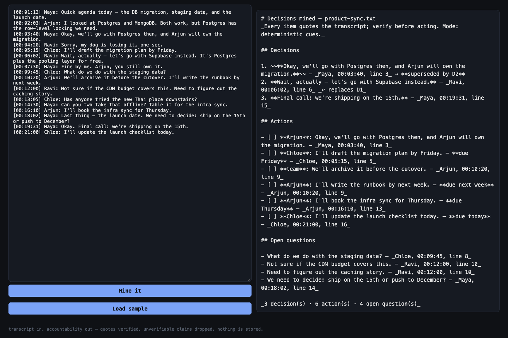

# decision-miner

**Day 10 of 30** · [Retro](RETRO.md) · [Build log](BUILD-LOG.md)

> "Is there anyone else who forgets what was decided in the meetings?" — r/remotework, with sibling asks for free summarizers; the named tools (Otter, Fireflies) are paywalled
> [thread →](https://www.reddit.com/r/remotework/comments/1qr195n/is_there_anyone_else_who_forgets_what_was_decided/)

Transcript in, accountability out. Drop a meeting transcript (`.txt` with `Name:` turns and timestamps, or a `.vtt`/`.srt` export) and get decisions, actions with owners and due dates, and open questions as Markdown — **every line citing the speaker, timestamp, and file line it came from**. No bots on your calls, no audio, no diarization, no accounts, nothing stored.

- **The deterministic core is the product, not the fallback.** Curated cue lists find `we'll go with X`, `final call:`, `NAME will VERB`, `I'll … by Friday`, `not sure if…` — a wrong owner is refused (`?` + "asked by Maya") rather than guessed, an unlabeled transcript says "owners unknown", and a reversal ("wait, actually — let's go with Supabase") **supersedes the earlier decision in both directions** (struck through, pointed at each other). Grep shows you both; only one of them is true.
- **The optional LLM pass is on a leash.** `--llm` (any OpenAI-compatible endpoint via env) adds recall — but every item it returns must carry a quote that **verbatim-matches the transcript** (whitespace/diacritic-folded). Unverifiable claims are dropped and counted, owners that aren't in the speaker list null out, and items are re-anchored to their transcript line so the report keeps the meeting's order, not the model's. `--llm` that can't deliver = exit 2 with the reason; the grounded report prints either way — never a silent fallback.
- **Exit trichotomy** (day-04/08 carry-over): `0` report with items · `1` readable but nothing decidable (report still printed) · `2` cannot check — unreadable file, non-UTF-8 bytes, >2 MB, bad flags, LLM undeliverable. Refusals name the true reason.
- **One decode path.** CLI and the FastAPI drop-zone call the same `process_bytes` seam — `utf-8-sig` (BOM tolerated), anything else refused; control bytes reach output only as Unicode pictures (␇ ␍), never raw.



## Run it

```bash
python3 decision_miner.py fixtures/product-sync.txt          # report to stdout, exit 0
python3 decision_miner.py meeting.vtt -o report.md           # write to file, unix-quiet
python3 decision_miner.py meeting.txt --llm                  # + verified-LLM pass; needs
                                                             #   DECISION_LLM_KEY or OPENAI_API_KEY
                                                             #   (optional DECISION_LLM_URL / OPENAI_BASE_URL,
                                                             #    DECISION_LLM_MODEL, default gpt-4o-mini)
```

The drop-zone face (one endpoint + one inline page, no build step):

```bash
uv run --with fastapi --with uvicorn python3 server.py      # http://127.0.0.1:5210
curl --data-binary @meeting.txt 'http://127.0.0.1:5210/mine?raw=1'   # same report, no browser
```

## What it looks like

```text
## Decisions

1. ~~**Okay, we'll go with Postgres then, and Arjun will own the migration.**~~ — _Maya, 00:03:40, line 3_ → **superseded by D2**
2. **Wait, actually — let's go with Supabase instead.** — _Ravi, 00:06:02, line 6_ _↩ replaces D1_
3. **Final call: we're shipping on the 15th.** — _Maya, 00:19:31, line 15_

## Actions

- [ ] **Arjun**: Okay, we'll go with Postgres then, and Arjun will own the migration. — _Maya, 00:03:40, line 3_
- [ ] **Chloe**: I'll draft the migration plan by Friday. — **due Friday** — _Chloe, 00:05:15, line 5_
- [ ] **team**: We'll archive it before the cutover. — _Arjun, 00:10:20, line 9_

## Open questions

- What do we do with the staging data? — _Chloe, 00:09:45, line 8_
```

## How it decides

| Decision | Rule | Why |
|----------|------|-----|
| Speaker | `Name:` label, `<v Name>` VTT voice, `[HH:MM:SS]`/cue timestamps inherited; NOTE/STYLE blocks skipped | labels are metadata the export already carries; diarization is a scope cut |
| Decision | curated cues (`we'll go with`, `final call:`, `agreed on`, …) | recall lives in the LLM pass; the core must never invent |
| Reversal | reversal cue + decision cue in one sentence → supersedes most recent decision | "forgets what was decided" is worst when the FIRST answer is the remembered one |
| Owner | speaker-verified `NAME will VERB` > `I'll`→speaker > `we'll+commit-verb`→team > `can you`→`?` with asker named; a named committer who never speaks is refused, not guessed | refusal beats a wrong name (D08 identity rule); "we" is flagged as team, never a person |
| Due | `by/before/due/for <date-vocab>`, or a date-vocab word ending the sentence (possessives excluded) | "before the cutover" is an event, not a date — kept out of the vocabulary |
| Negation | `can't/won't/will not…` sentences never yield actions | a refused commitment is not a commitment |
| Line numbers | 1-based over `\n`-split lines (never `splitlines()`); CRLF normalized; a `\r`-only file is an old-Mac transcript | stray `\r` must not phantom-split lines and drift citations from what an editor shows |
| LLM claims | quote ≥ 8 folded chars, fold-matching the transcript AND locatable to a line; owner must fold-match a speaker (no speakers → every owner is invented); `--llm` failure = named exit 2, grounded report still printed | a hallucinated decision is worse than a missed one — this tool's whole job is trust |
| Ordering | report sorts by transcript position, LLM items included | never inherit a provider's ordering (D02) |
| Parking meta | "take that offline" / "table it" routes around item-hood | it's talk about the discussion, not an item |

## Validate it works

```bash
python3 self_check.py        # 63 assert-based checks (also pytest-collectable)
```

Covers: hand-counted fixture expectations (counted twice), VTT voice tags + cue-timestamp inheritance + NOTE/STYLE blocks, SRT, BOM, lone-`\r` line integrity, C1/bidi control markers, fold matching, reversal pointers + the list-alias regression that broke them, LLM quote verification (fabricated *and vacuous* claims dropped+counted, unknown owners nulled, fences tolerated, transcript order kept, both-sides-of-a-reversal merges), and the full exit matrix in-process and pipe-free via subprocess. Real-browser verified: file drop auto-mines, paste+button mines, undecodable upload refused with its reason.

Then a fresh-context adversarial pass (**23 findings, every one reproduced twice before it counted** — 2 HIGH, 12 MED, 9 LOW): the `--llm` failure path exited 1 with a traceback instead of 2 with the report; vacuous quotes (pure combining-marks, a bare `Maya:`) verified anything; the merge could delete grounded cue items with a 4-char quote of the wrong kind and erase reversals when the model returned both sides; C1/bidi control bytes leaked raw; multi-line quotes were rejected as unverifiable; VTT NOTE blocks were mined as speech with a phantom speaker. **18 fixed with named regressions (F1–F22 in the check suite), 5 marked as documented ceilings** (cue-list precision on idioms, `[99:99]` echoed as-is, questions without `?`, prose-before-JSON endpoints, junk claims counted as dropped — the honest count). Details in the [build log](BUILD-LOG.md).

## Deliberately not built

No meeting-record bots, no live audio, no speaker diarization, no calendar/Slack integration, no storage or accounts (file in, Markdown out), no conversation resolution ("agreed?" + later "yes" stays a question — named ceiling), no embeddings/RAG over meeting history. Every shortcut is marked in code with a `ponytail:` comment naming its ceiling and trigger.

## Files

- `decision_miner.py` — the tool (stdlib only): parser, cue miner, verified LLM pass, CLI
- `server.py` — FastAPI drop zone (one endpoint + one inline page)
- `self_check.py` — the one runnable check (40 checks)
- `fixtures/` — a hand-counted product sync (16 lines), a VTT export, an honest-empty, and a hostile transcript (BOM, control bytes)
